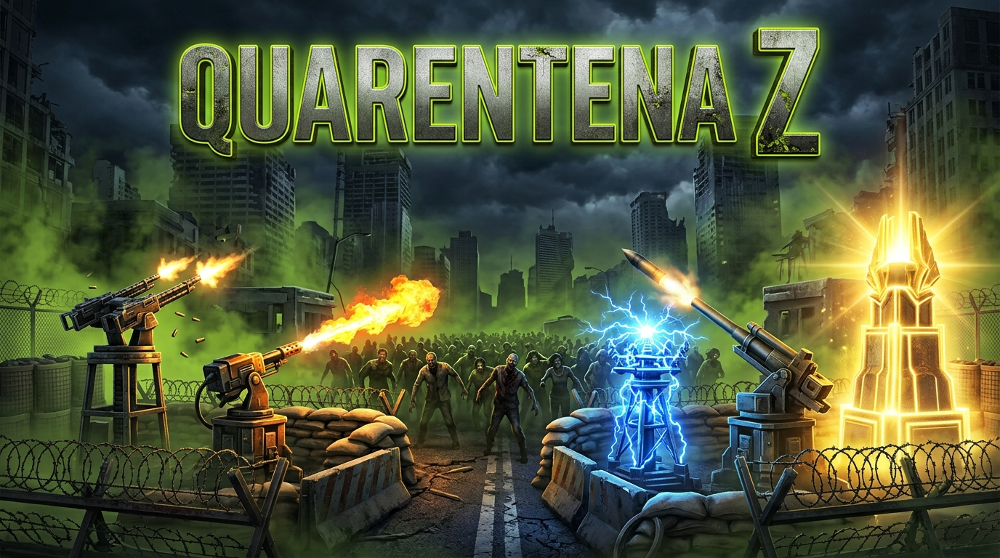
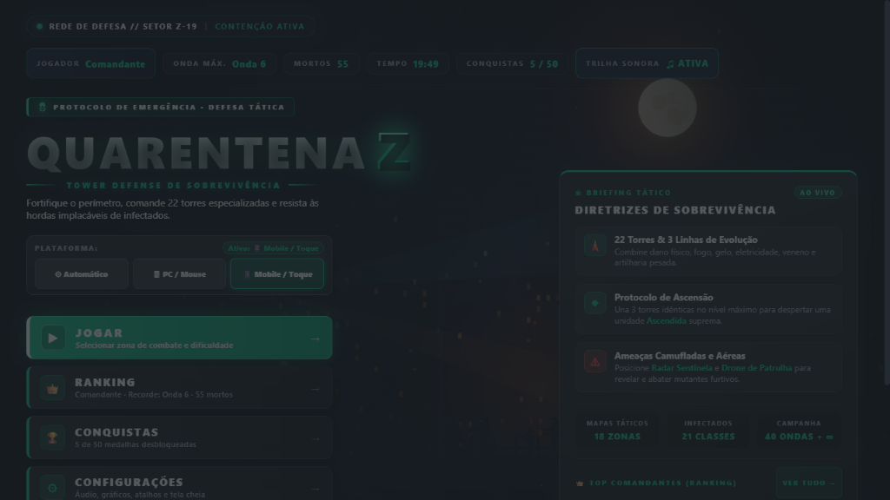
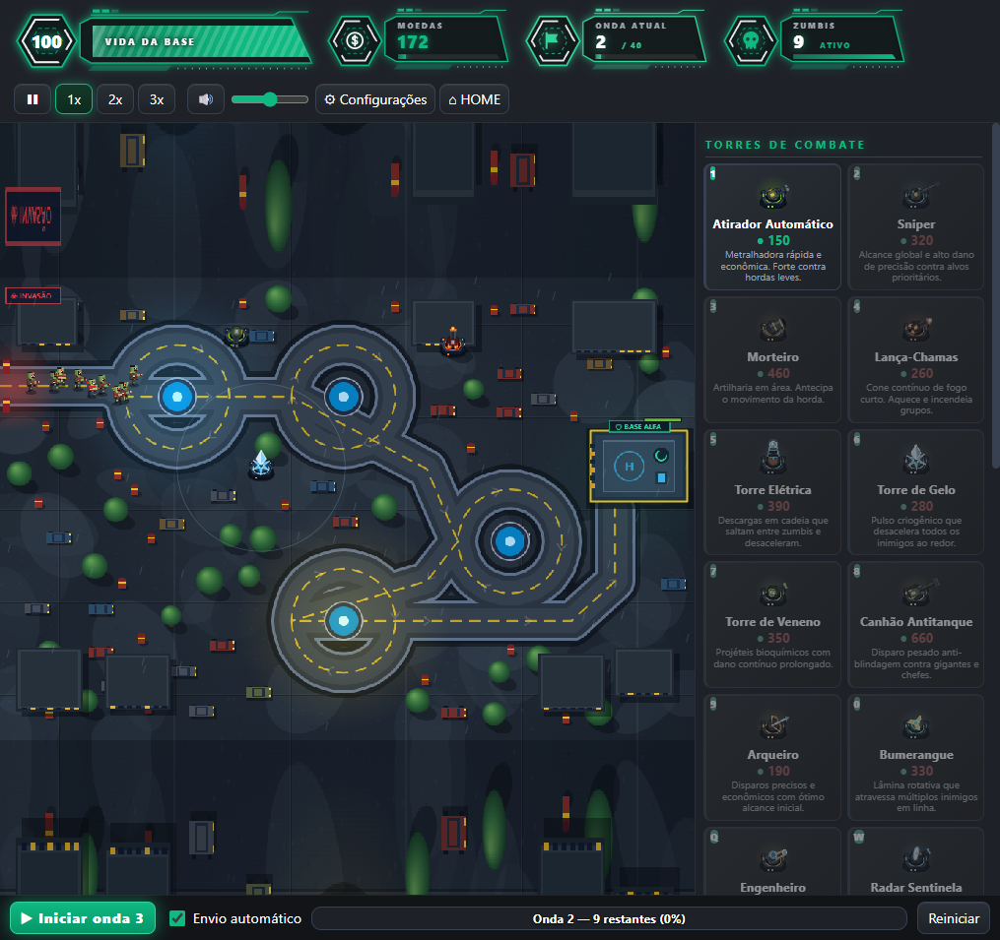
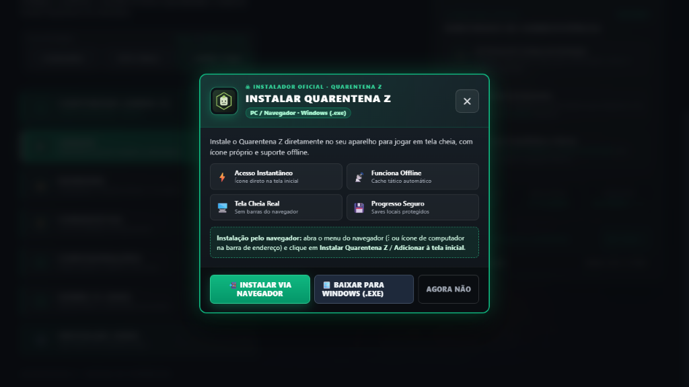
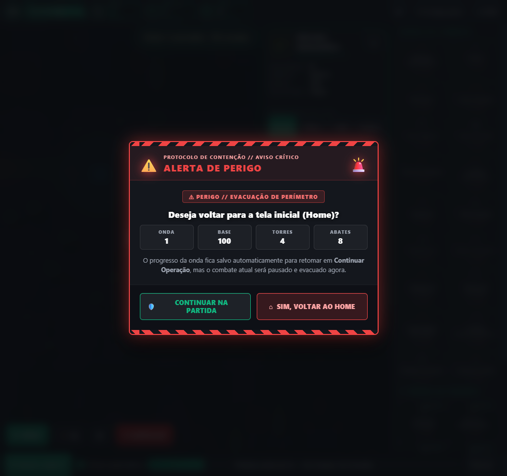
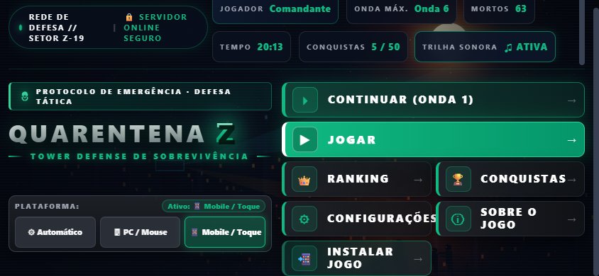
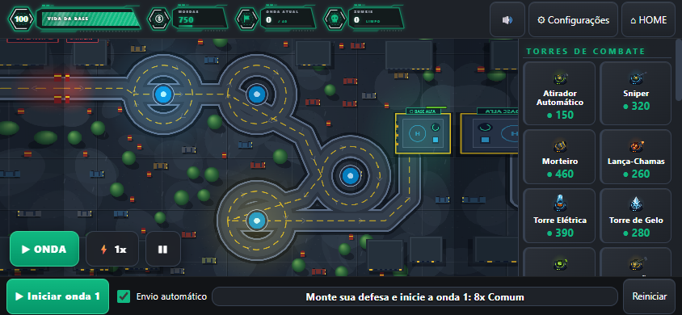

  

# Quarentena Z

Tower defense estratégico de zumbis em HTML5/JS: defenda o último perímetro de Vale Cinzento com **22 torres especializadas**, **upgrades em 3 linhas**, **Protocolo de Ascensão**, **18 mapas**, versão **PWA instalável** para navegador/celular e **instalador Windows**.

## Jogar / Baixar
- **Jogar no Navegador (PC e Celular — PWA instalável):** https://marlonpereiradefreitas-rgb.github.io/jogos/
- **Baixar para Windows (.exe Instalador e Portátil):** https://github.com/marlonpereiradefreitas-rgb/jogos/releases/latest
- **Android / iOS:** abra o link do navegador acima e toque em **`📲 INSTALAR JOGO`** no menu inicial (ou *Adicionar à Tela de Início* no iOS).

---

## Capturas Reais do Jogo

| Menu Inicial | Batalha e Torres |
|---|---|
|  |  |

| Tela de Instalação Personalizada | Tela de Voltar ao Home |
|---|---|
|  |  |

| Mobile Paisagem (844×390) — Menu | Mobile Paisagem (844×390) — Partida |
|---|---|
|  |  |

---

## Lore (Resumo)
Vale Cinzento foi isolada quando a Febre Pálida escapou dos laboratórios subterrâneos da Corporação Aurora. Sem exército, os sobreviventes converteram armas de oficina e tecnologia improvisada em torres de contenção. A história completa está em [quarentena-z/LORE.md](quarentena-z/LORE.md).

## Projeto e Documentação
Todo o código-fonte fica organizado dentro da pasta [`quarentena-z/`](quarentena-z/):
- [Documentação completa (README)](quarentena-z/README.md)
- [História do universo (LORE)](quarentena-z/LORE.md)
- [Balanceamento, Mobile e Mudanças (CHANGELOG)](quarentena-z/CHANGELOG.md)
- [Auditoria e Proteções (SECURITY)](quarentena-z/SECURITY.md)

## Licença
MIT. Veja [LICENSE](LICENSE).
