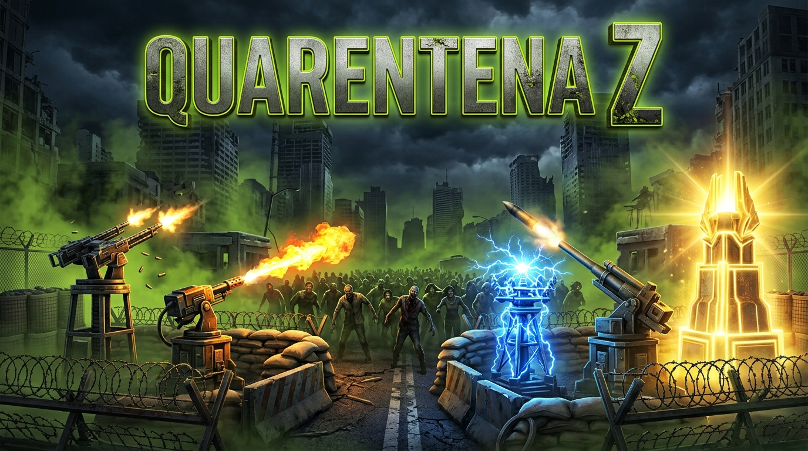
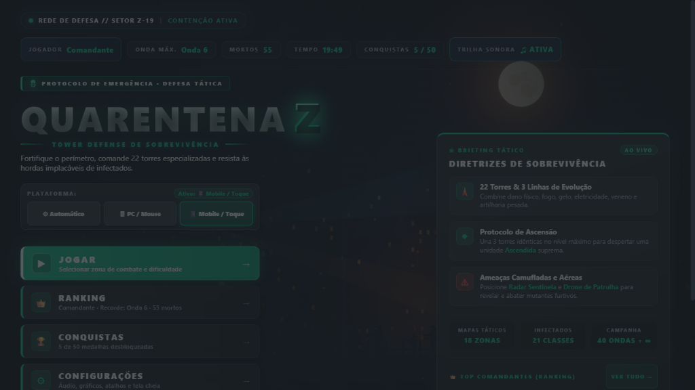
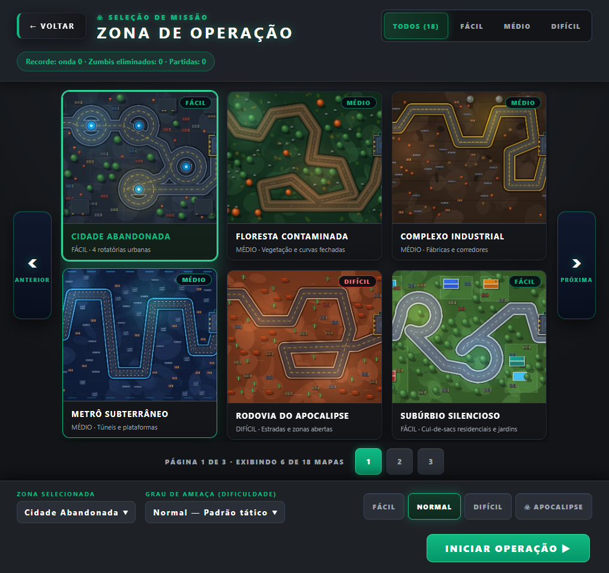
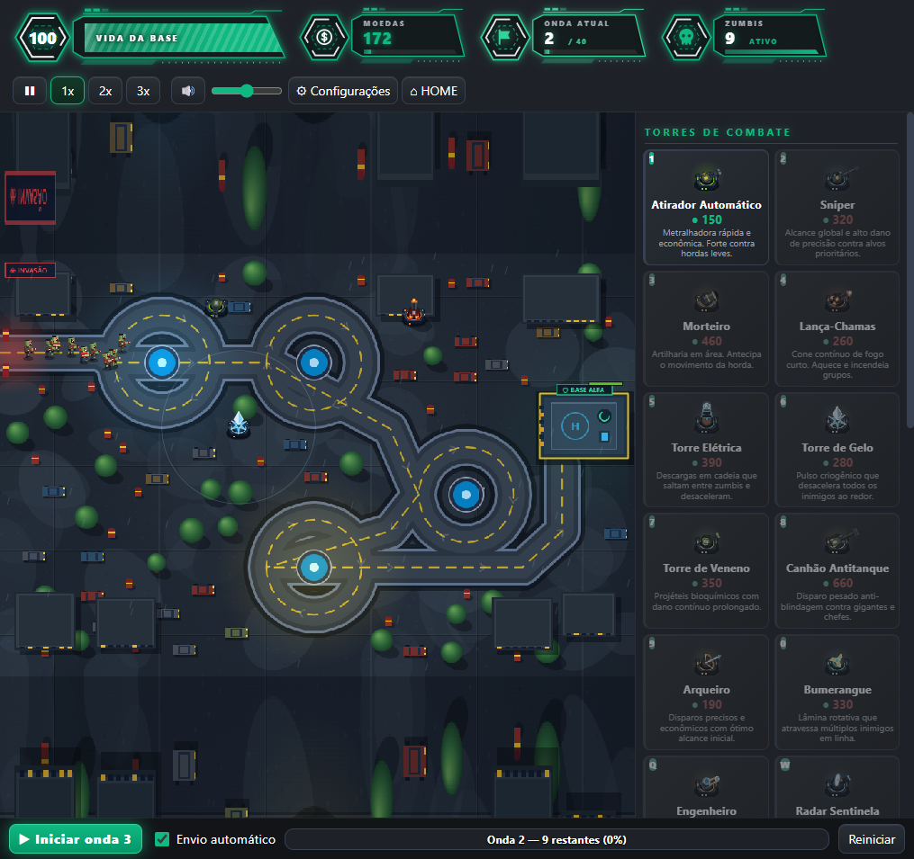
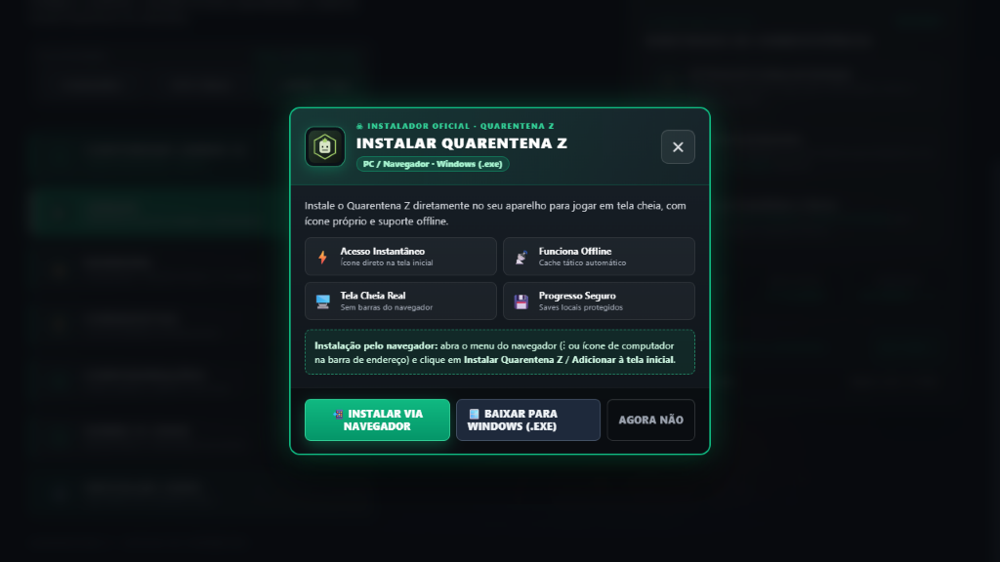
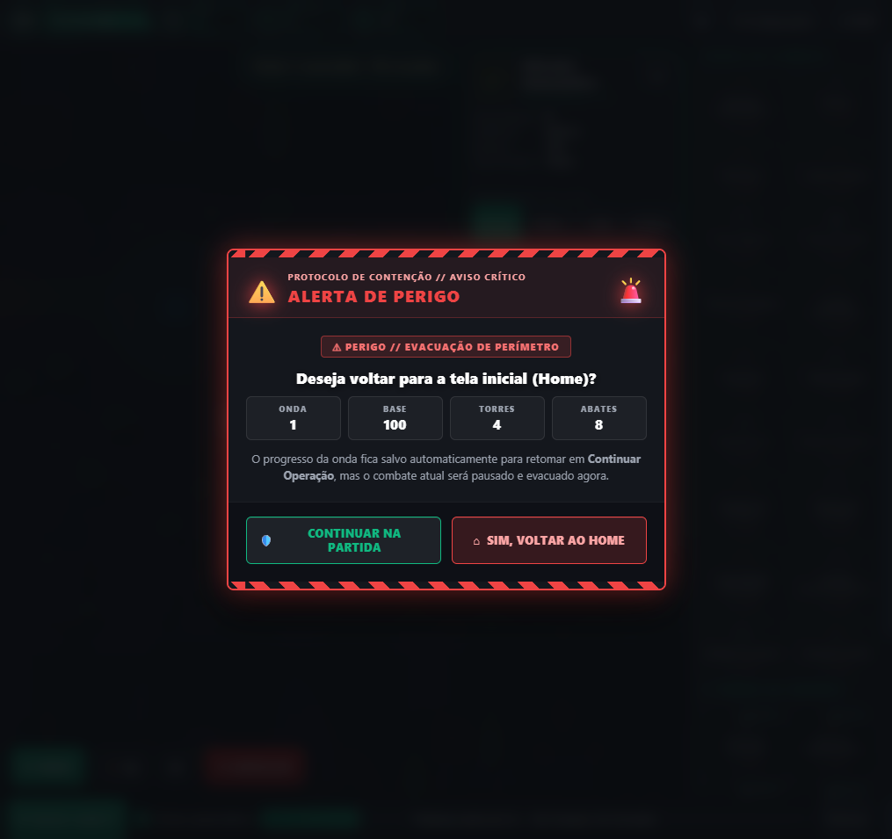
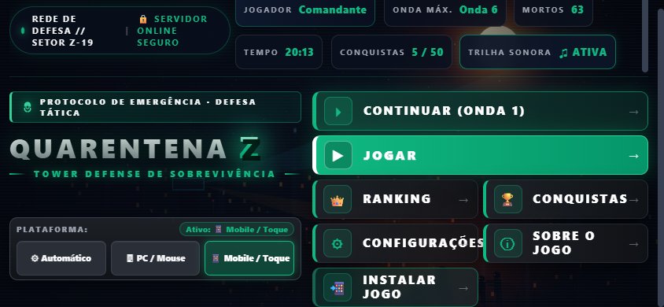
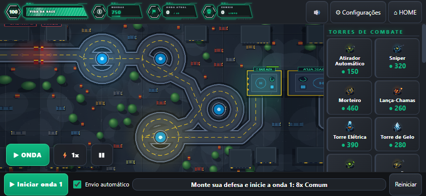

# Quarentena Z

Tower defense estratégico de sobrevivência contra zumbis em HTML5/JS, com versão para **Navegador / PWA** (PC, Android e iOS), **PC Desktop (Windows/Electron)** e **servidor Node.js opcional** para ranking e cloud save protegidos por HMAC-SHA256.

## Jogar / Baixar

- **Jogar Agora no Navegador (PC e Celular — PWA instalável):** https://marlonpereiradefreitas-rgb.github.io/jogos/
- **Baixar para Windows (.exe Instalador e Portátil):** https://github.com/marlonpereiradefreitas-rgb/jogos/releases/latest
- **Android / iOS (Instalar como App):** abra o link acima no Chrome (Android) ou Safari (iOS) e clique em **`📲 INSTALAR JOGO`** no menu inicial (ou "Adicionar à Tela de Início").

---

## Galeria do Jogo (Capturas Reais)

| Menu Inicial (Desktop) | Seleção de Mapas (18 Zonas) |
|---|---|
|  |  |

| Combate & Torres (Desktop) | Tela de Instalação Personalizada |
|---|---|
|  |  |

| Tela Personalizada para Voltar ao Home | Mobile Paisagem (Menu & Partida 844×390) |
|---|---|
|  |  |



---

## Principais Recursos
- **22 torres únicas** (combate direto, área, controle, suporte tático/econômico/médico), com **3 linhas de evolução**, **5 níveis** e **Protocolo de Ascensão** (una 3 torres idênticas no nível máximo para despertar uma unidade Ascendida com aura e orbes orbitais).
- **18 mapas táticos** e **4 dificuldades** (Fácil, Normal, Difícil, Apocalipse) + **40 ondas de campanha** e **Modo Infinito**.
- **21 classes de infectados**, incluindo camuflados, voadores, blindados, curandeiros e chefes a cada 10 ondas.
- **Mobile-first em paisagem**: botões táteis `>= 44px`, aviso automático de rotação em modo retrato, barra rápida mobile (`▶ ONDA`, `⚡ 1x`, `❚❚`), Wake Lock para tela acesa, salvamento automático ao minimizar/trocar de app e opção de **Economia de Bateria (30/60 FPS)**.
- **PWA Offline**: Service Worker com cache do shell (~423 KB sem gzip) e tela personalizada de instalação.
- **Segurança**: CSP sem `'unsafe-inline'` em scripts (`script-src 'self'`), anti-XSS e servidor Node opcional com assinatura HMAC-SHA256.

---

## História (Lore)
Vale Cinzento foi isolada pela Corporação Aurora quando a Febre Pálida escapou dos laboratórios subterrâneos. Sem exército, os sobreviventes transformaram armas de oficina, equipamentos de obra e geradores industriais nas torres que defendem o último perímetro. Leia a história completa em [LORE.md](LORE.md).

---

## Controles

### PC (Mouse e Teclado)
- **Clique esquerdo**: selecionar, construir ou melhorar torre.
- **`1`–`0` e `Q`–`S`**: selecionar torre rápida; **`Shift` + Clique** para construir várias em sequência.
- **`Espaço`**: pausar / continuar · **`N`**: próxima onda · **`F`**: velocidade (`1x`/`2x`/`3x`) · **`F3`**: medidor de FPS · **`Esc`**: cancelar / fechar painel.

### Mobile (Toque)
- **Toque no card da torre + toque no mapa**: posicionar torre.
- **Barra Rápida Mobile** (canto inferior esquerdo): `▶ ONDA`, `⚡ 1x/2x/3x`, `❚❚ Pausar`, `✕ Cancelar`.
- **Jogar em modo paisagem** (o jogo pausa automaticamente e exibe aviso ao girar para retrato).

---

## Requisitos e Tecnologias
- **Navegador / Mobile**: Chrome, Edge, Firefox ou Safari atualizado (suporte a Canvas 2D e Web Audio).
- **Windows Desktop**: Windows 10/11 x64 (~80 MB livres para o instalador Electron).
- **Rodar localmente (opcional, Node.js >= 18)**:
```bash
npm install
cp .env.example .env   # defina QZ_SECRET (ex: openssl rand -hex 32)
npm run web            # servidor em http://localhost:8080
npm start              # versão desktop (Electron)
```

---

## Testes e Documentação
- `node tools/test-upgrades.js game.js` — valida todas as compras de upgrade.
- `node tools/test-save.js game.js` — valida determinismo e save/load.
- `node tools/test-backend.js` — valida segurança HTTP, DRM, HMAC e CSP.
- `node tools/stress-logic.js game.js` — benchmark de simulação sob hordas extremas.
- Documentos: [LORE.md](LORE.md) · [CHANGELOG.md](CHANGELOG.md) · [SECURITY.md](SECURITY.md) · [CREDITS.txt](CREDITS.txt) · Licença [MIT](../LICENSE).
